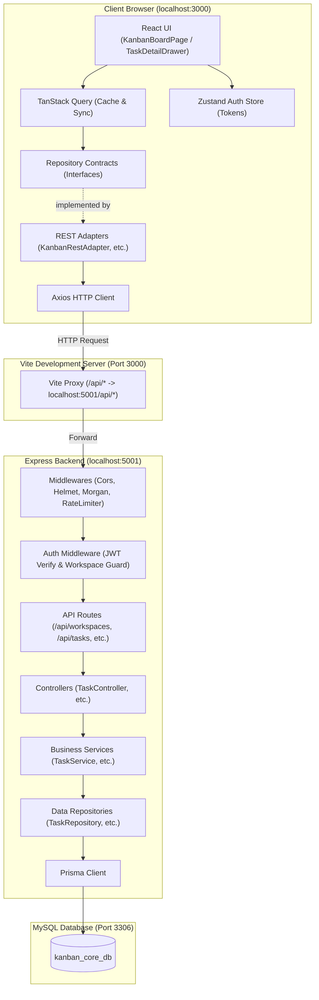
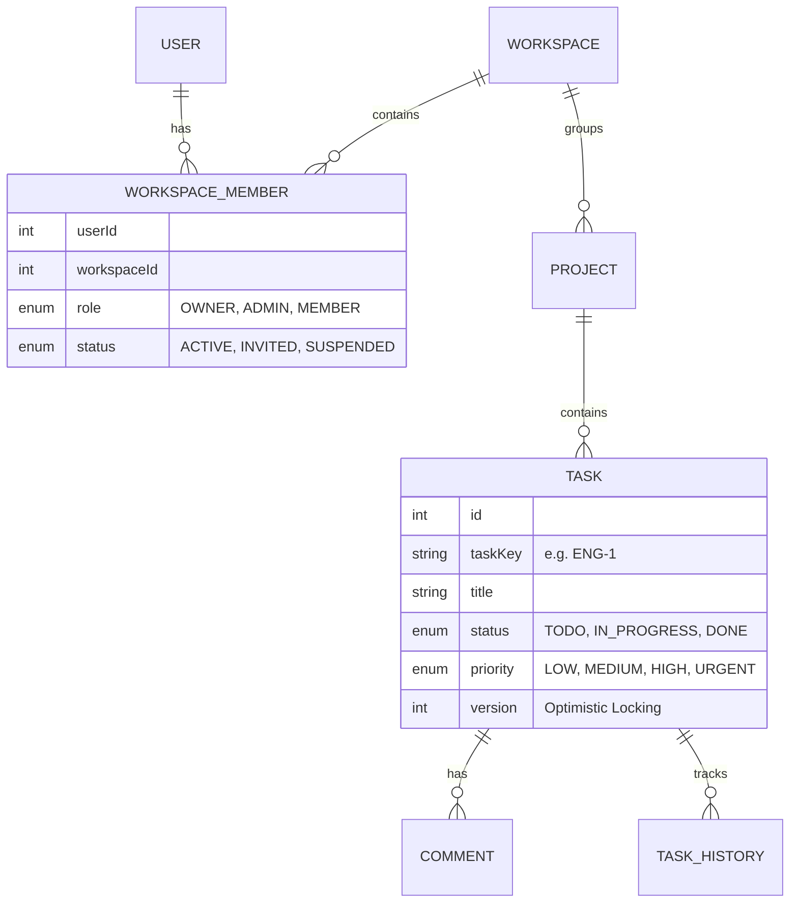
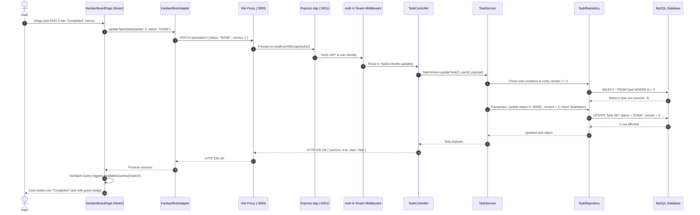

# Full-Stack Kanban Platform — Architecture & System Design Document

> **Purpose**: This document provides an exhaustive, beginner-friendly yet production-grade explanation of the entire frontend and backend architecture for this Linear/Jira-style Kanban project. It is structured so that you or any AI (like ChatGPT) can read, teach, and expand upon every design pattern, file, and data flow.

---

## 1. Executive Summary & Tech Stack

This project is a modern, multi-tenant task and project management platform inspired by tools like Linear and Jira. It is split into two halves:

1. **Frontend (`e:/new-architecture`)**: React 18 SPA built with Vite, TypeScript, Tailwind CSS, TanStack Query (React Query v5), and Zustand.
2. **Backend (`e:/new-architecture/backend-node`)**: RESTful API built with Node.js, Express, TypeScript, Zod validation, and Prisma ORM running against a MySQL database.

### Technology Matrix

| Layer | Technology | Primary Role |
| :--- | :--- | :--- |
| **Frontend Framework** | React 18 + Vite | Fast HMR development, component lifecycle, rendering |
| **Language** | TypeScript (Strict mode) | Type safety across API contracts and UI states |
| **Styling** | Tailwind CSS + Lucide Icons | Responsive UI, dark theme, glassmorphic Linear aesthetic |
| **Server State** | TanStack Query v5 | Automatic caching, refetching, and mutation invalidation |
| **Client State** | Zustand | Global authentication state (JWT tokens, active user) |
| **HTTP Client** | Axios (configured) | Request interceptors, JWT refresh loop, standard errors |
| **Backend Framework**| Express.js 4 | REST routing, middleware chaining |
| **Validation** | Zod | Runtime schema validation for query params and bodies |
| **ORM / Database** | Prisma 5 + MySQL 8 | Multi-file schema models, type-safe queries, migrations |
| **Authentication** | JWT (Access + Refresh) | Stateless bearer token authentication + sliding refresh |

---

## 2. High-Level Architecture Diagram



---

## 3. Frontend Architecture Deep-Dive (`src/`)

The frontend follows the **Hexagonal / Ports-and-Adapters Architecture**. This decouples UI components from specific network protocols or data sources.

### 3.1 Folder Structure

```
src/
├── components/          # Reusable design-system UI components (Button, Modal, Input, Badge)
├── config/              # Centralized environment variables and endpoint registries
│   ├── endpoints.ts     # Single source of truth for all API URLs
│   └── env.ts           # Type-safe environment variables
├── features/            # Feature-sliced domain modules
│   ├── auth/            # LoginPage, RegisterPage, authStore (Zustand)
│   ├── dashboard/       # Dashboard overview page
│   └── kanban/          # KanbanBoardPage, TaskDetailDrawer, Modals
├── layouts/             # Page wrappers (AppLayout, Sidebar, Navbar, AuthLayout)
├── lib/                 # Core utilities (axios instance with interceptors, utils)
├── routes/              # React Router v6 tree with ProtectedRoute guards
├── services/            # Clean Architecture contracts and adapters
│   ├── contracts/       # TypeScript interfaces (Ports: IKanbanRepository, etc.)
│   ├── adapters/        # Concrete implementations (Adapters: REST, Mock)
│   └── index.ts         # Dependency injection entry point
└── types/               # Domain TypeScript definitions (TaskItem, Workspace, etc.)
```

### 3.2 Key Patterns Explained

#### Pattern A: Ports & Adapters (Dependency Inversion)
Instead of calling `axios.get('/api/tasks')` directly inside React components:
1. **Contract (Port)**: `src/services/contracts/kanban.repository.ts` defines:
   ```typescript
   export interface IKanbanRepository {
     listTasks(projectId: number): Promise<TaskItem[]>;
     updateTaskStatus(taskId: number, status: TaskStatus): Promise<TaskItem>;
     createTask(projectId: number, data: CreateTaskPayload): Promise<TaskItem>;
   }
   ```
2. **Adapter**: `src/services/adapters/rest/kanban.rest.adapter.ts` implements this interface using Axios.
3. **DI Container**: `src/services/index.ts` exports `kanbanService = new KanbanRestAdapter()`.
4. **Benefit**: The UI only depends on the interface. If you ever switch to GraphQL, Firebase, or WebSockets, you only swap the adapter — zero UI code changes.

#### Pattern B: Automatic Token Refresh via Axios Interceptors (`src/lib/axios.ts`)
- **Request Interceptor**: Reads the active `accessToken` from Zustand state and injects `Authorization: Bearer <token>`.
- **Response Interceptor**: If an API returns `401 Unauthorized`, it pauses subsequent requests in a queue, hits `/api/auth/refresh` using the `refreshToken`, saves the new token in Zustand, and replays all queued requests seamlessly.

#### Pattern C: Kanban Board & Drag-and-Drop (`KanbanBoardPage.tsx`)
- Uses native HTML5 Drag and Drop (`onDragStart`, `onDragOver`, `onDrop`).
- When a task card is dropped onto a new column:
  1. `e.dataTransfer.getData('text/plain')` retrieves the `taskId`.
  2. `moveTaskMutation.mutate({ taskId, newStatus })` calls `kanbanService.updateTaskStatus`.
  3. On success, `queryClient.invalidateQueries(['tasks', selectedProjectId])` refetches the project tasks immediately.

#### Pattern D: Task Detail Drawer (`TaskDetailDrawer.tsx`)
- An off-canvas slide-out panel that opens when a task card is clicked.
- Loads full details (including comments and audit trail) using `kanbanService.getTask(taskId)`.
- Features optimistic concurrency: sends `version: task.version` when saving. If someone else modified the task in between, the backend rejects it with `409 Conflict`.
- Allows posting comments that immediately appear in the task's activity feed.

---

## 4. Backend Architecture Deep-Dive (`backend-node/`)

The backend follows a strict **4-Layer Clean Architecture**:

$$\text{Route} \;\longrightarrow\; \text{Validation (Zod)} \;\longrightarrow\; \text{Controller} \;\longrightarrow\; \text{Service} \;\longrightarrow\; \text{Repository} \;\longrightarrow\; \text{Prisma ORM}$$

### 4.1 Folder Structure

```
backend-node/
├── prisma/
│   ├── schema/                  # Multi-file Prisma schema folder
│   │   ├── base.prisma          # Database client and datasource config
│   │   ├── enums.prisma         # TaskStatus, TaskPriority, WorkspaceRole enums
│   │   ├── user.prisma          # User and RefreshToken models
│   │   ├── workspace.prisma     # Workspace and WorkspaceMember models
│   │   ├── project.prisma       # Project model
│   │   ├── task.prisma          # Task and TaskLabel models
│   │   ├── comment.prisma       # TaskComment model
│   │   └── activity.prisma      # TaskHistory audit model
│   └── seeds/                   # Domain-separated database seeders
├── src/
│   ├── config/                  # DB connection and environment config
│   ├── constants/               # HTTP status codes and error constants
│   ├── middlewares/             # Security, CORS, logging, auth, tenant guards
│   ├── modules/                 # Domain modules (auth, workspace, project, task, comment)
│   │   └── [module]/
│   │       ├── [module].routes.ts       # Express router definitions
│   │       ├── [module].validation.ts   # Zod request schemas
│   │       ├── [module].controller.ts   # HTTP request/response handlers
│   │       ├── [module].service.ts      # Pure business rules & logic
│   │       └── [module].repository.ts   # Database queries via Prisma
│   ├── utils/                   # ApiResponse, ApiError, JWT helpers
│   ├── app.ts                   # Express application setup
│   └── server.ts                # HTTP server listener (Port 5001)
```

### 4.2 Responsibility of Each Layer

1. **Routes (`*.routes.ts`)**:
   - Maps URL patterns and HTTP methods to controllers.
   - Attaches middleware: authentication (`authenticate`), multi-tenant guards (`requireWorkspaceMember`), and input validation (`validate({ body, query })`).

2. **Validation (`*.validation.ts`)**:
   - Built with Zod. Validates and coerces incoming JSON payloads and URL query params.
   - Example: Ensuring task titles are between 2 and 255 characters, status matches the enum, and version is a positive integer.

3. **Controller (`*.controller.ts`)**:
   - Extracts parameters (`req.params`, `req.body`, `req.query`, `req.user`).
   - Delegates business operations to the Service.
   - Formats responses using `ApiResponse.send(res, { data, message, statusCode })`.
   - Never contains direct database queries.

4. **Service (`*.service.ts`)**:
   - Contains pure business rules and authorization policies.
   - Example rule: *"An assignee assigned to a task must be an active member of that project's workspace."*
   - Example rule: *"Optimistic locking: check if the incoming version matches current version, increment version on update."*

5. **Repository (`*.repository.ts`)**:
   - Encapsulates all Prisma database operations (`prisma.task.findMany`, `prisma.$transaction`, etc.).
   - Insulates the service from database-specific query semantics.

---

## 5. Multi-Tenancy & Authorization Model

This platform is **multi-tenant at the Workspace level**:



### Authorization Rules:
1. **Workspace Boundary**: A user cannot read or write projects or tasks belonging to a workspace where they do not have an active `WorkspaceMember` record.
2. **`requireWorkspaceMember` Middleware**:
   - Examines `req.params.workspaceId`, `req.query.workspaceId`, or header `x-workspace-id`.
   - Verifies the user's membership in MySQL.
   - Attaches `req.workspaceMember = { workspaceId, role }` to the request.
3. **Role-Based Permissions**:
   - `OWNER` / `ADMIN`: Can invite members, update workspace details, and delete projects.
   - `MEMBER`: Can create tasks, edit tasks, post comments, and move cards.

---

## 6. End-to-End Request Flow: Dragging a Task to "Completed"

Here is what happens under the hood when a user drags a task on the Kanban board:



---

## 7. Optimistic Concurrency Control Explained

In high-concurrency environments (multiple teammates moving cards simultaneously), classic updates can overwrite someone else's work (Lost Update Problem).

### How this project solves it:
1. Every `Task` record has a `version: Int @default(1)` column.
2. When the frontend loads a task, it receives `version: 1`.
3. When sending an update, the frontend sends `{ ...fields, version: 1 }`.
4. The backend runs:
   ```typescript
   if (existingTask.version !== input.version) {
     throw new ConflictError('Task was modified by another user. Please refresh.');
   }
   // If matches, increment version atomically:
   await prisma.task.update({
     where: { id: taskId },
     data: { ...data, version: existingTask.version + 1 }
   });
   ```
5. If two users save at the exact same moment, the second user receives an HTTP 409 Conflict, preventing silent data corruption.

---

## 8. Cheat Sheet for Explaining to ChatGPT

If you want to paste this into ChatGPT or an interview study session, use this prompt:

> *"I am sharing the architecture document of my full-stack Kanban board project built with React 18, TypeScript, Vite, Tailwind CSS, TanStack Query, Express.js, Prisma, and MySQL. Please review this document and act as my senior engineering mentor. You can quiz me on the architecture, help me explain the Ports and Adapters pattern, review the multi-tenant security model, or suggest code implementations for upcoming features like subtasks and WebSockets."*
